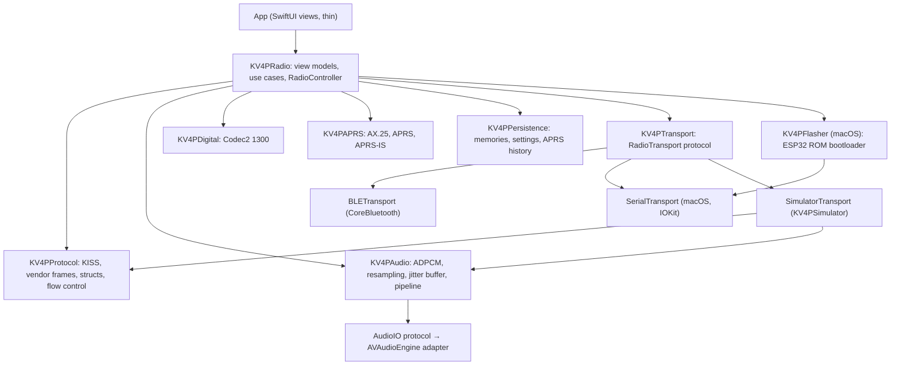

# 02 — Architecture

Status: draft. Decisions behind this design are in [adr/](adr/README.md).

## Goals

- One native SwiftUI app for macOS, iOS and iPadOS ([ADR-0003](adr/0003-app-technology.md),
  [ADR-0012](adr/0012-platform-strategy.md)).
- All logic in platform-neutral Swift packages, testable with `swift test` on the
  Mac ([ADR-0011](adr/0011-coverage-policy.md)).
- Byte-level compatibility with firmware and Android, proven by golden vectors
  ([ADR-0004](adr/0004-android-code-reuse.md)).

## Layers



Dependencies point downwards only. `KV4PProtocol` has no dependencies and holds
every protocol constant ([03-protocol-spec.md](03-protocol-spec.md)).

## Packages

| Package | Responsibility | Platform-specific parts |
|---|---|---|
| `KV4PProtocol` | KISS encoder/decoder, vendor frame codec, `HostDesiredState`, `DeviceState`, `Hello`, `WindowUpdate`, flags, S-meter, flow-control window | none |
| `KV4PTransport` | `RadioTransport` protocol (async byte stream + connection state), BLE chunking/reassembly, device discovery | CoreBluetooth adapter; IOKit serial adapter (macOS) |
| `KV4PAudio` | IMA ADPCM codec, 16 kHz pipeline, jitter buffer, mic gain, `AudioIO` protocol | AVAudioEngine adapter; AVAudioSession adapter (iOS) |
| `KV4PDigital` | Codec2 1300 Swift wrapper | vendored C library |
| `KV4PAPRS` | AX.25 frames, APRS parse/format, beacon scheduling, APRS-IS client | none (Network.framework behind a protocol) |
| `KV4PPersistence` | repository protocols + SwiftData implementation | none |
| `KV4PRadio` | `RadioController` state machine (connecting, handshake, RX, TX, scan, error), use cases, `@Observable` view models | none |
| `KV4PFlasher` | ESP32 ROM bootloader protocol (SLIP, sync, baud change, flash, MD5 verify), firmware image set | macOS only; DTR/RTS control in the serial adapter |
| `KV4PSimulator` | device-side protocol state machine, fake ROM bootloader, scenarios, signal generators | none |

App targets:

| Target | Content |
|---|---|
| `App` | SwiftUI views and composition root (dependency wiring), macOS + iOS + iPadOS |
| `kv4p-sim-peripheral` | macOS command-line app: `SimulatorPeripheral` with the `CBPeripheralManager` adapter around `KV4PSimulator` ([ADR-0014](adr/0014-radio-simulator.md)) |

## Key abstractions

```swift
public protocol RadioTransport: Sendable {
    var state: AsyncStream<TransportState> { get }
    var incoming: AsyncStream<[UInt8]> { get }   // raw KISS byte chunks
    func connect() async throws
    func send(_ bytes: [UInt8]) async throws
    func disconnect() async
}

public protocol AudioIO: Sendable {
    func startPlayback(format: PCMFormat) async throws
    func play(_ samples: [Int16]) async
    func startCapture(format: PCMFormat) -> AsyncStream<[Int16]>
    func stop() async
}
```

RX playback uses the pull-based `AudioOutput` instead of `AudioIO.play`
([ADR-0020](adr/0020-rx-audio-pipeline.md)).

Hardware adapters implement these protocols and contain no logic beyond
forwarding; they are the only coverage exclusions.

## Concurrency

- Swift 6 strict concurrency. `RadioController` is an `actor`; view models are
  `@MainActor @Observable`.
- Transport bytes flow through `AsyncStream`s; the KISS decoder is a pure value
  type fed from the stream.
- Audio callbacks hand samples to a lock-free ring buffer owned by the adapter;
  the rest of the pipeline is synchronous and deterministic for tests.

## Mapping Android → Apple

| Android | Apple |
|---|---|
| `radio/Protocol.java` | `KV4PProtocol` |
| `radio/RadioTransport.java`, `BleKissRadioTransport`, `UsbSerialRadioTransport` | `KV4PTransport` |
| `radio/ImaAdpcm.java`, `MicGainBoost` | `KV4PAudio` |
| `radio/RadioAudioService.java`, `RadioModuleController`, `ConnectionController` | `KV4PRadio` (split into controller, audio pipeline and use cases) |
| `javAX25/`, `java-aprs`, `AprsBeaconSchedule`, `AprsRfFrequencyPolicy` | `KV4PAPRS` |
| `data/` (Room) | `KV4PPersistence` (SwiftData) |
| `ui/*Activity`, `MainViewModel` | `App` views + `KV4PRadio` view models |
| `firmware/FirmwareUtils`, `esp32-flash-lib` | `KV4PFlasher` (macOS) + version check in `KV4PRadio` ([ADR-0009](adr/0009-firmware-updates.md)) |

## Configuration

- `apple-src/Config/Base.xcconfig`: bundle identifier
  `io.github.cookieberlin.kv4pht`, deployment targets 26
  ([ADR-0008](adr/0008-minimum-os-versions.md)), version numbers.
- Entitlements: Bluetooth, microphone, location (APRS beacons), network client;
  iOS background modes `audio` and `bluetooth-central` (phase 2).
