## A native app for the kv4p HT

The [kv4p HT](https://www.kv4p.com) is an open source handheld ham radio for 2 m or 70 cm: a small board that
the phone controls, with no screen or buttons of its own. Its project makes the radio and an Android app. This
app is an unofficial port for Apple devices by DB3AC, written in Swift and SwiftUI for iPhone, iPad and Mac. It is not
affiliated with the kv4p HT project, which makes and sells the radio. See [kv4p.com](https://www.kv4p.com) for
what it looks like, how to build one and where to buy it.

::: screenshots
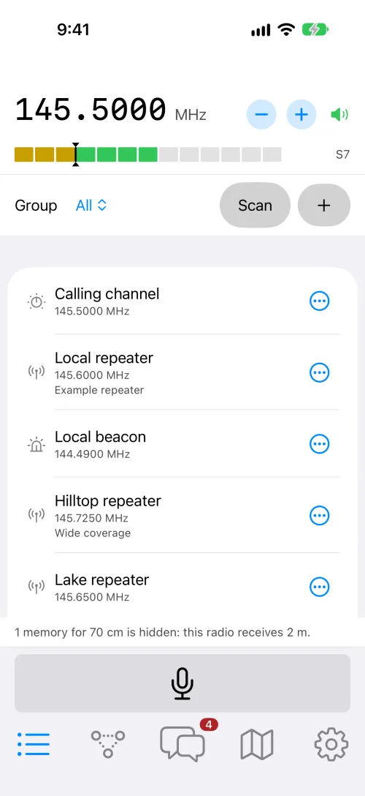{.iphone}

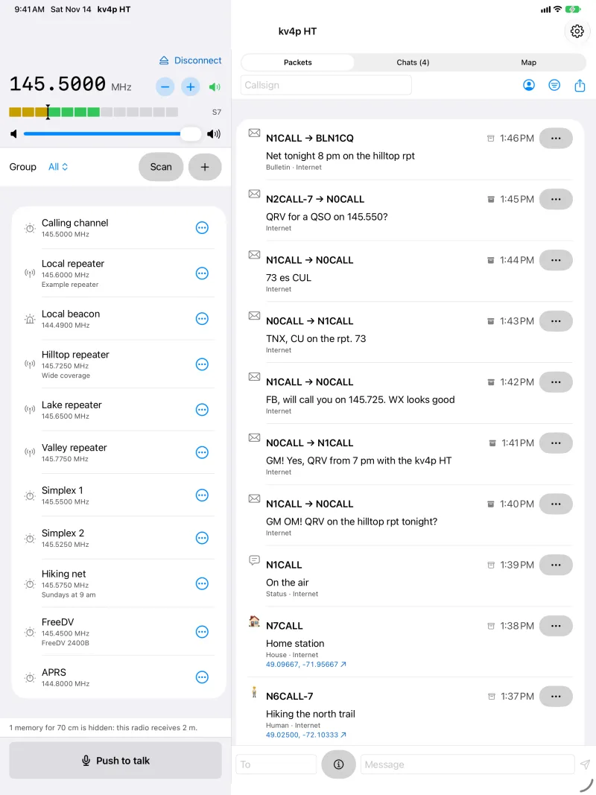{.ipad}

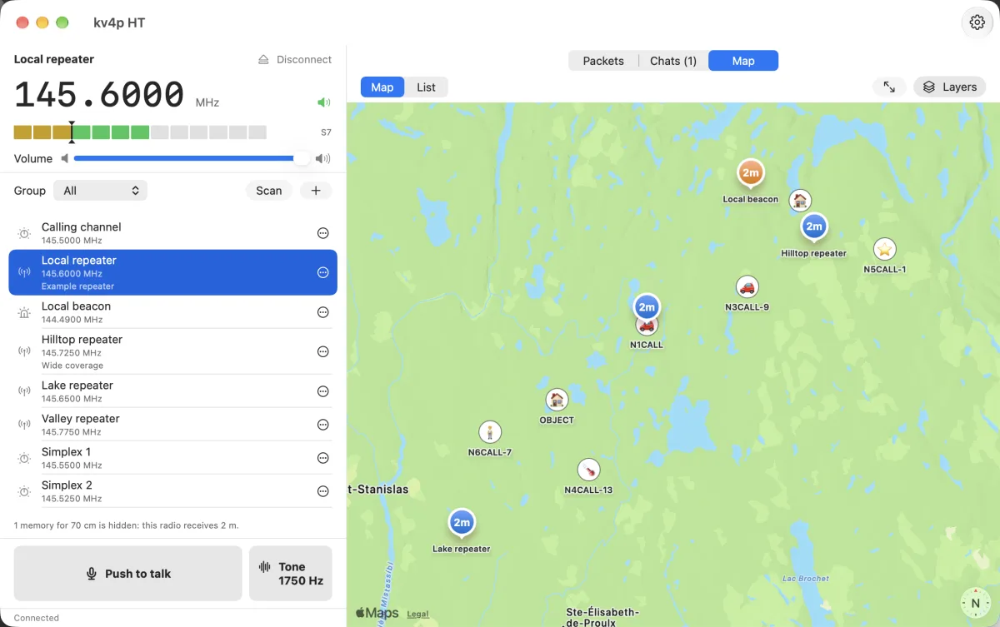{.mac}
:::

## Features {#features}

::: features
::: feature

### Bluetooth LE and USB

Connects over Bluetooth LE on all devices, and over USB on the Mac. Reconnects by itself.

:::

::: feature

### Receive and transmit

Push to talk, squelch, S-meter and tuning digit by digit, within the limits of the ham bands. A repeater access
tone of 1000, 1450, 1750 or 2100 Hz.

:::

::: feature

### Memories and scanning

Memories in groups, a scan that stops on signals, and imports of RepeaterBook and DARC repeater lists.

:::

::: feature

### iCloud sync

Memories, groups, callsign and a few settings in your own iCloud account, on all your devices.

:::

::: feature

### APRS

Packets, messages and chats, position beacons, a fill-in digipeater, and an iGate and feed over APRS-IS.

:::

::: feature

### FreeDV 2400B

Digital voice with Codec2, on the same FM radio.

:::

::: feature

### In the background

On iPhone and iPad, audio and APRS go on with the screen locked, while the radio is connected.

:::

::: feature

### Firmware updates

The Mac app brings the firmware the app needs, and writes it to the radio over USB.

:::

::: feature

### Try it without a radio

A built-in radio simulator, and a virtual radio over Bluetooth that a Mac can provide for another device.

:::

::: feature

### Private

No account, no ads, no tracking. The developer collects no data. See [Privacy](privacy.md).
:::
:::

## A look at the app {#screenshots}

The pictures follow the colour scheme of the switch at the top, or of your device.

::: gallery
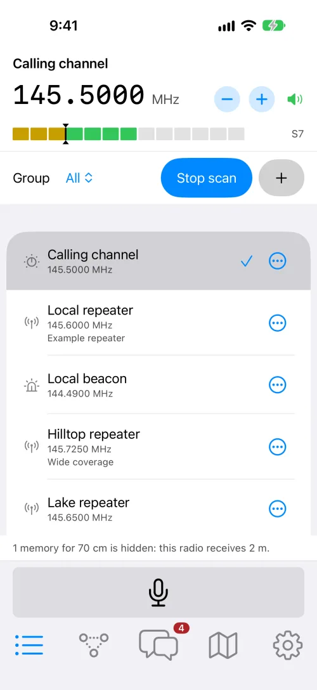

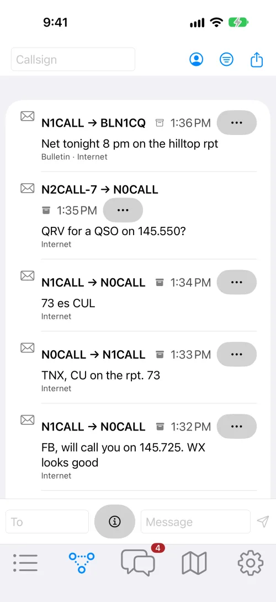

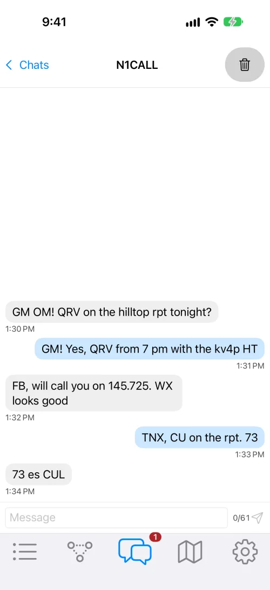

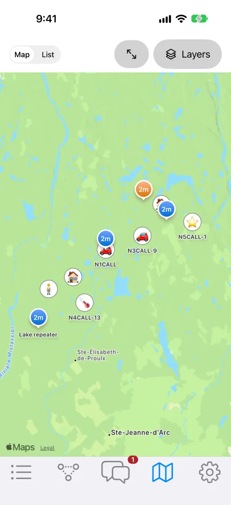

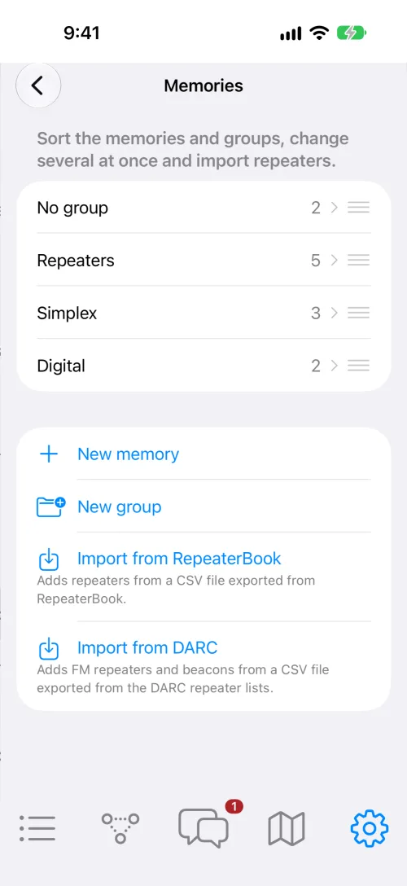

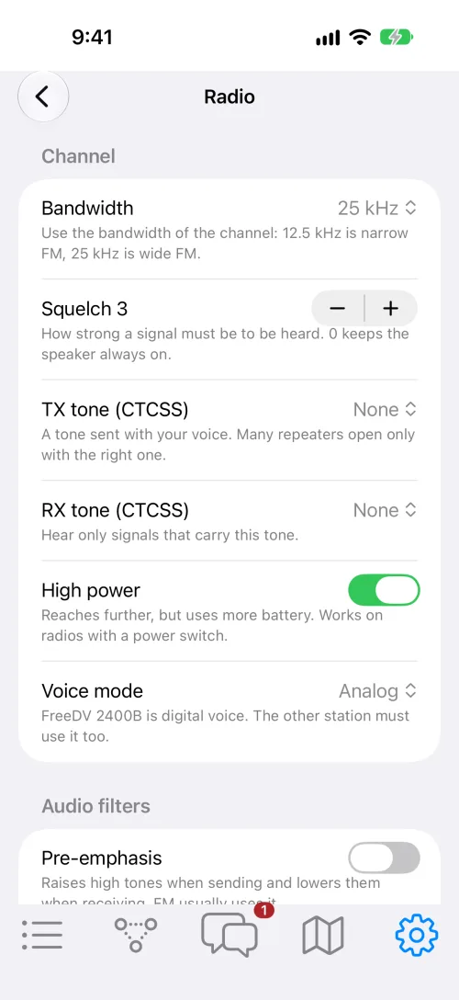

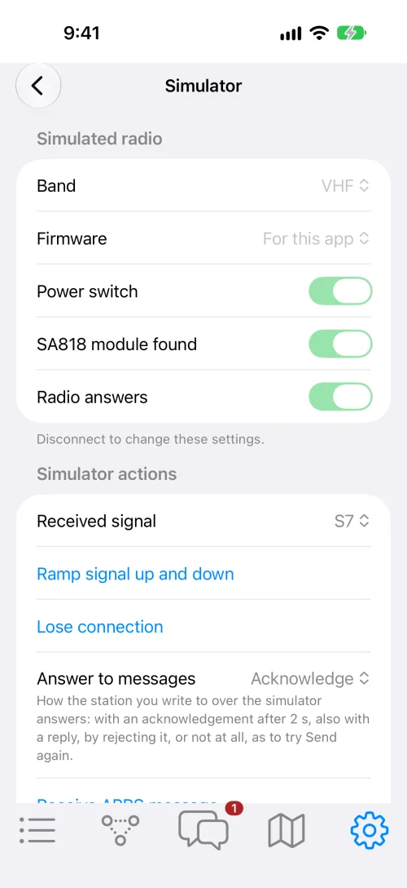

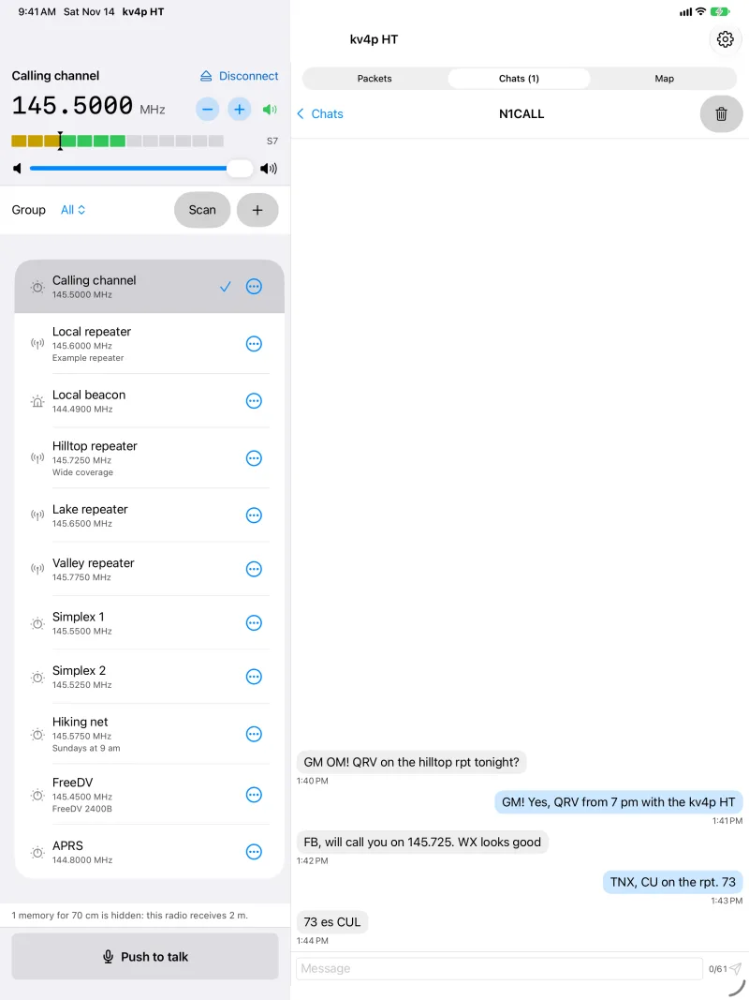{.wide}

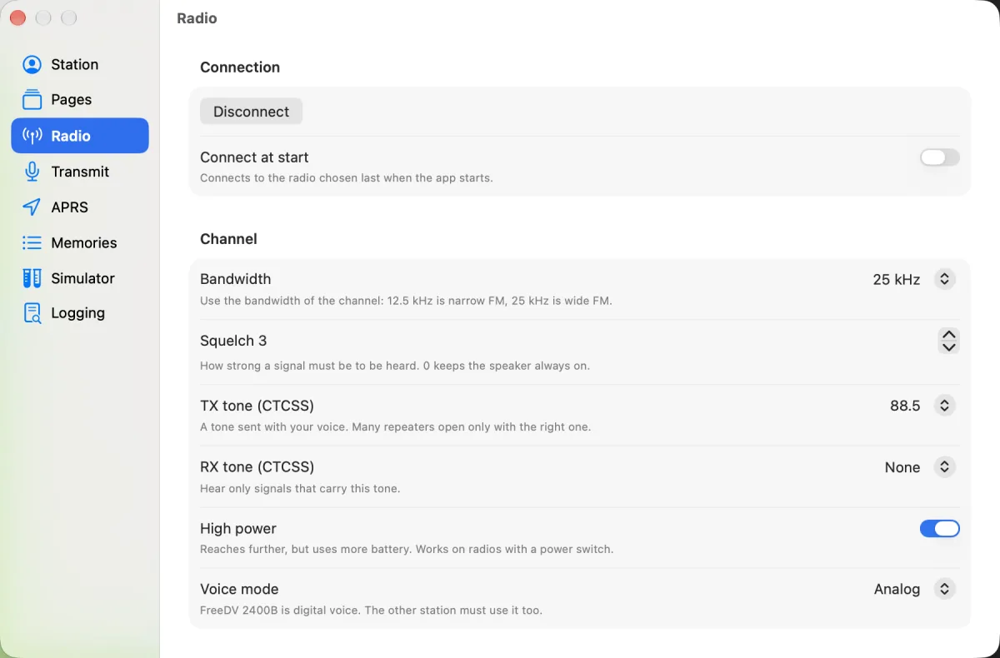{.wide}
:::

## Requirements

- iPhone or iPad with iOS or iPadOS 27 or later, or a Mac with Apple Silicon and macOS 27 or later.
- A kv4p HT radio with the firmware for this app, the nightly build of the kv4p HT project. The Mac app can write
  it; see [Which firmware do I need?](../faq.md#which-firmware-do-i-need).
- A valid amateur radio licence to transmit. Receiving works without one.

## Get the beta

The app is in testing, and test builds come through Apple's TestFlight app:

::: steps

1. Install [TestFlight](https://apps.apple.com/app/testflight/id899247664) from the App Store.
2. Open the [public invitation]($testflight$) on your iPhone, iPad or Mac, and accept it in TestFlight.
3. A build runs for 90 days. TestFlight then offers the current one.
:::

The [manual](../manual.md) explains the app, and the [FAQ](../faq.md) answers common questions.
